# Autokerner

Spacing and kerning for FontLab 8, on all masters in one run.

[Русская версия](README.ru.md)

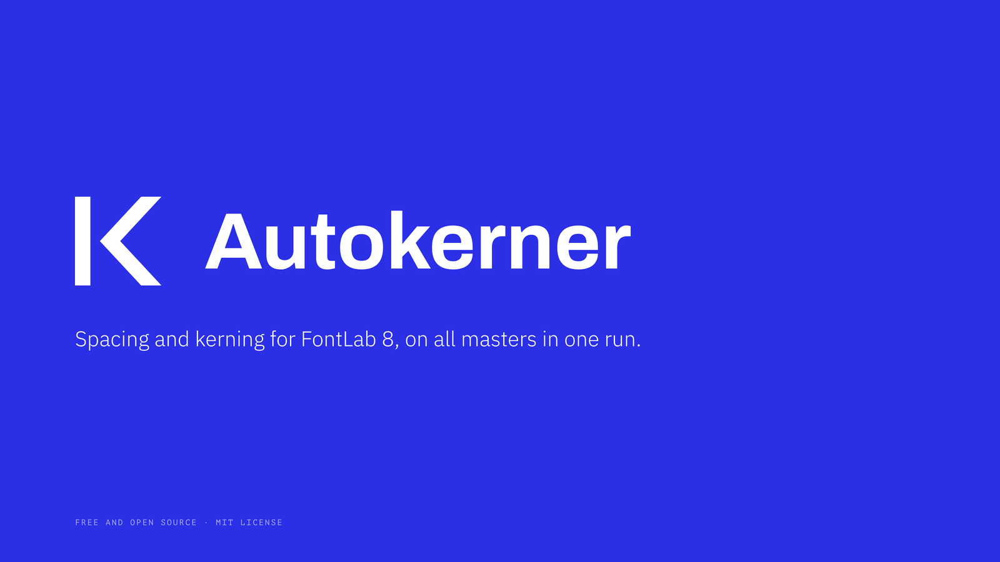

Autokerner is a free, open-source script for FontLab 8. It sets the
sidebearings, the word space and the kerning (classes and exception pairs) of
a whole font, on every master at once, with one set of kerning classes shared
by all masters, as a variable font needs. Nothing is written until you have
seen the result and pressed **Apply**, and the last write can be reverted.

## What it does

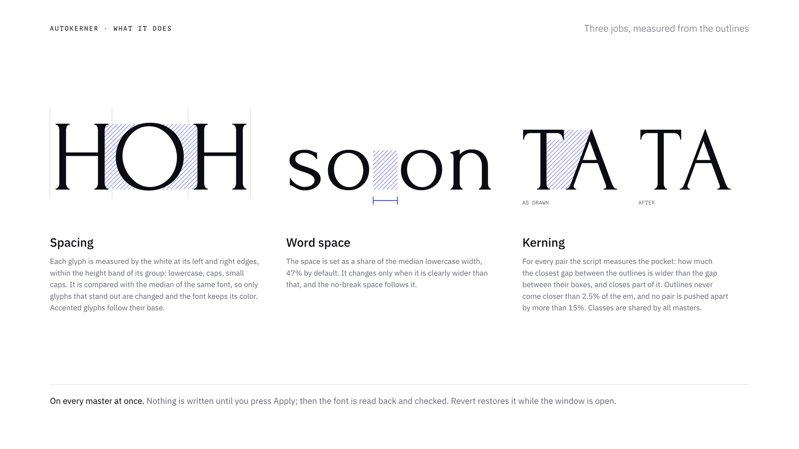

- **Spacing.** Each glyph is measured by the area of white at its left and
  right edges, within the height band of its group (lowercase, uppercase,
  small caps), and compared with the median of the same font. White right at
  the edge counts in full, deeper white counts less and less, white sheltered
  behind a crossbar or an arm counts little, and the white between the tip of a
  short serif and its stem counts three quarters, much as the eye sees it. Only glyphs that stand out from their own family are changed, so the font keeps its
  overall looseness or tightness. Accented letters follow their base letter,
  composites move with their base, punctuation is spaced against the stem of a
  straight letter. A word space that is much wider than the rule is narrowed
  to the edge of the tolerance, or, if you choose, all the way to the target.
- **Kerning.** For every pair the script measures the "pocket": how much wider
  the closest gap between the two outlines (including the shadow of
  overhangs) is than the gap between their bounding boxes. A share of the
  pocket is closed; the share differs for letters and for low, high and middle
  marks. Pockets no deeper than the font's usual one (the median of model
  pairs such as HO and no) are left alone. In a pair of two lowercase letters,
  the part of the left letter that rises above the right one, such as the hook
  of f over o, makes no pocket. Outlines never come closer than
  2.5% of the em. Figures never run into each other across `, . :`
  (7,4 · 3.5 · 12:30), and marks at different heights, such as a quote and a
  comma, are not moved under each other. Combining marks, standalone accents
  and the underscore are not kerned: they never stand next to letters in text.
  No pair is pushed apart by more than 15% of the em. Pairs are grouped into
  classes with values per master; pairs that do not fit their class are
  written by name.
- **Before / after.** The script calculates first and shows a summary, a live
  text line ("now" and "after") and every change in tables where you can untick
  what you don't want. After **Apply** the result is read back from the font
  and compared with the calculation. **Revert** puts the font back as it was.

The spacing and kerning rules are ported to Python from another program by
the author; with the window's corrections switched off, the numbers match it
to the unit on the test fonts, including a variable font with nine masters.

## Results

Before and after on real fonts: a text face, a slab display face, a text serif
and an art deco display face. Red marks what was off before the run.

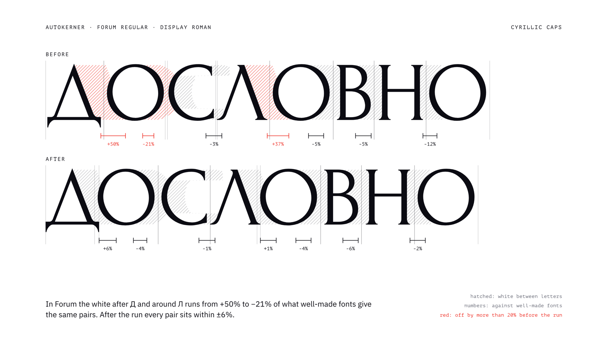

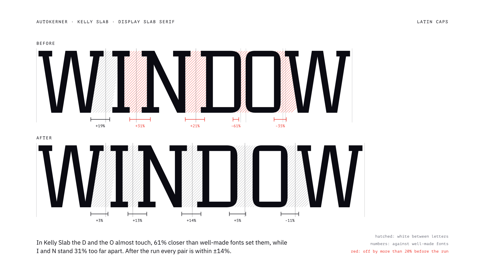

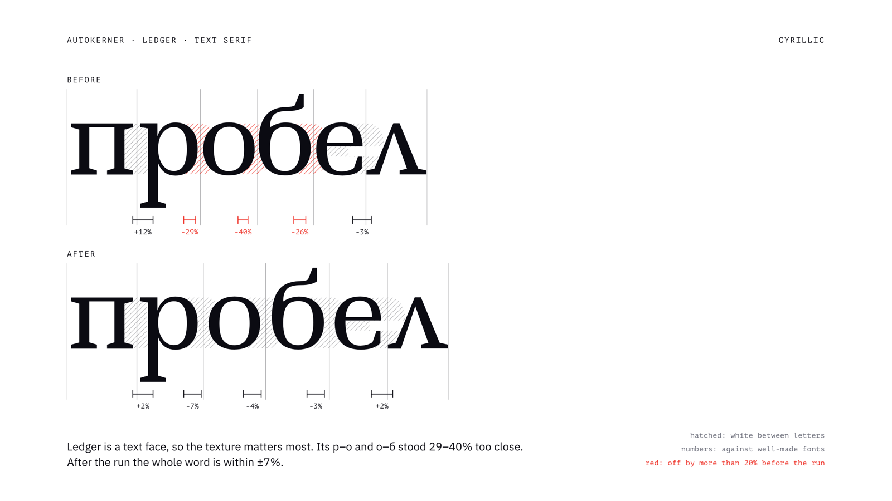

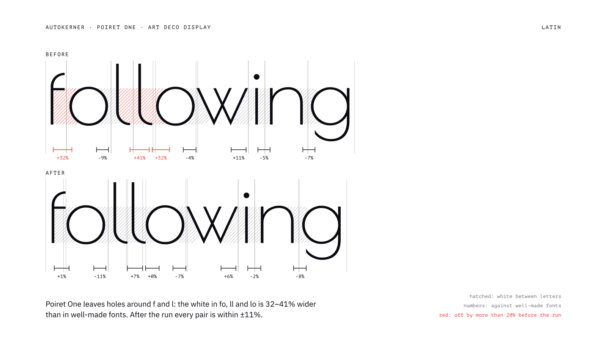

Every pair of a line against a tolerance, and all frequent pairs of the font at once:

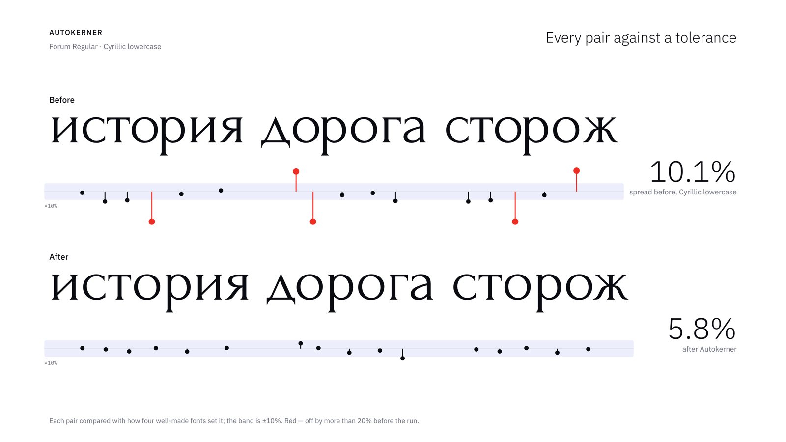

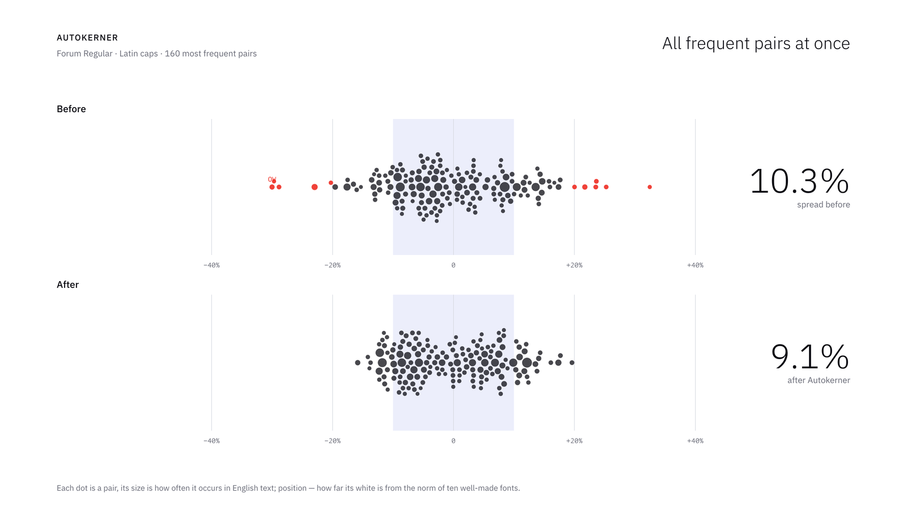

The author's fonts: a pangram before and after, a poster, and a display face
kerned by hand next to the same face kerned by the script from zero:

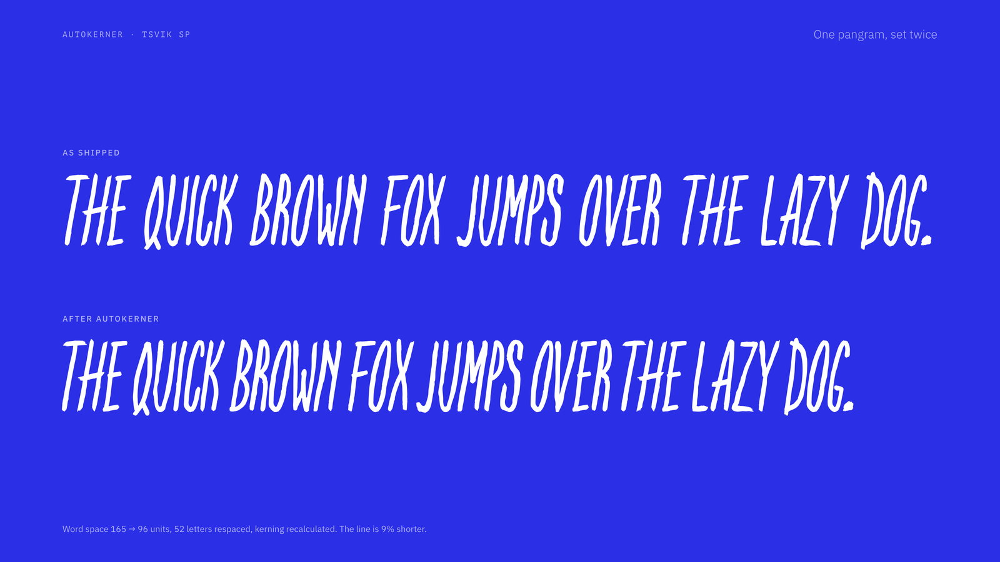

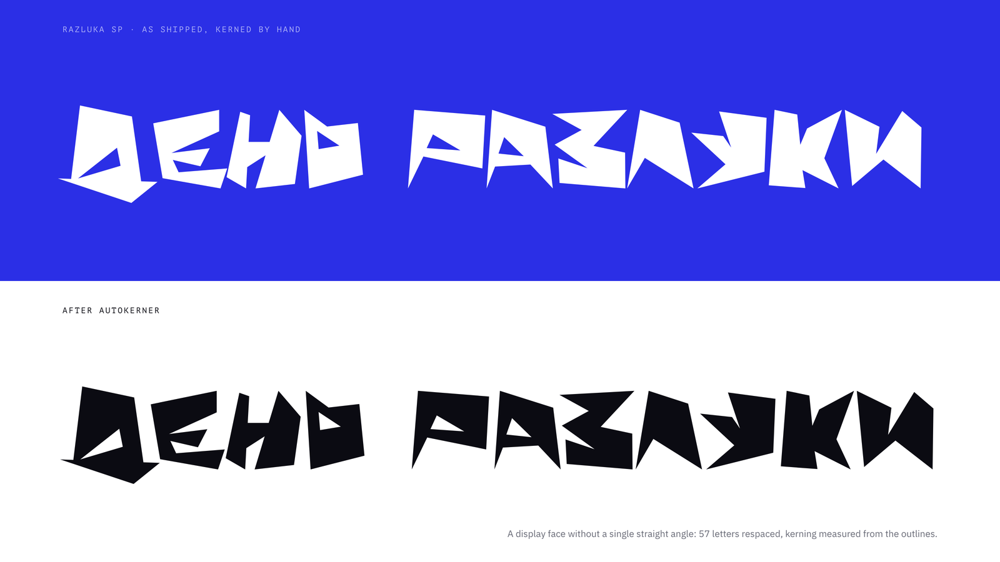

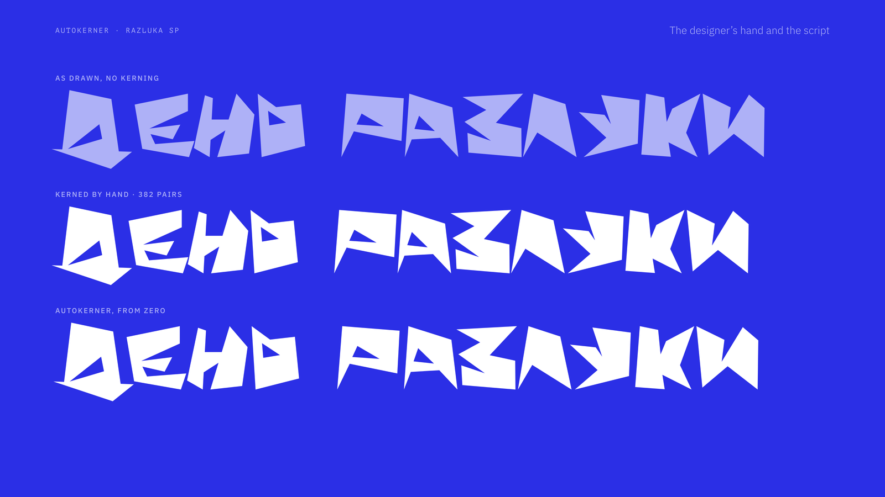

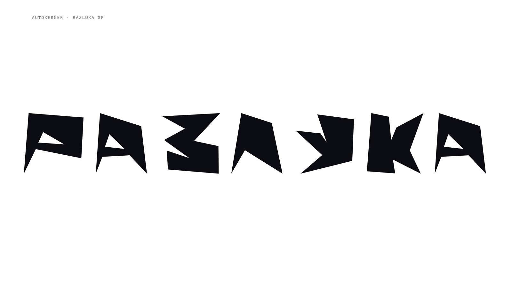

## Web version

The same calculation runs in the browser, on the author's site:
[pavljenko.ru/blogs/tools/autokerner](https://pavljenko.ru/blogs/tools/autokerner).
Drop a static TTF, OTF, WOFF or WOFF2 file, choose the settings and download
the respaced and rekerned font. Everything happens on your computer (Python
in WebAssembly through Pyodide); the font is not uploaded anywhere. The web
version writes the sidebearings, the word space and a new `kern` lookup into
the file, moves mark anchors with their glyphs, reads the new file back and
checks it against the calculation; the other tables stay as they were.
Variable fonts and fonts with several masters need the FontLab script.

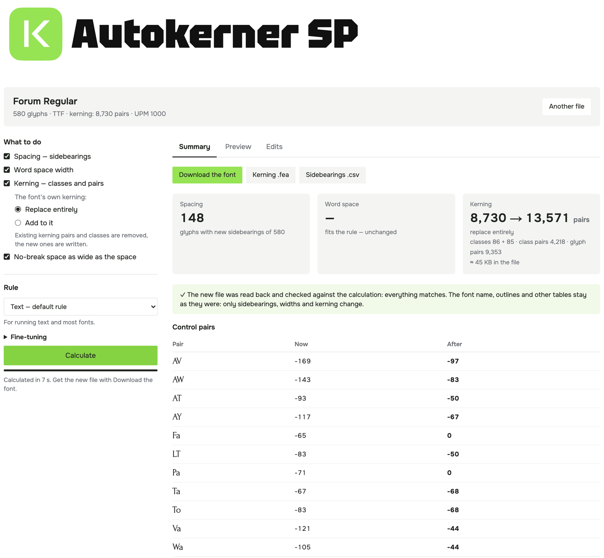

## Requirements

FontLab 8. Developed and tested with FontLab 8.4.3 on macOS; it should work
on Windows, but this has not been tested yet. No extra Python packages are
needed.

## Install

1. Download [`dist/Autokerner.py`](dist/Autokerner.py) (the **Download raw file** button),
   or the ZIP from the [latest release](../../releases/latest) or from
   [pavljenko.ru](https://pavljenko.ru/blogs/scripts/autokerner).
2. Put it into the FontLab 8 scripts folder:
   - macOS: `~/Library/Application Support/FontLab/FontLab 8/Scripts`
   - Windows: `%APPDATA%\FontLab\FontLab 8\Scripts`
3. Choose **Scripts → Refresh Scripts**. **Autokerner** appears in the
   Scripts menu.

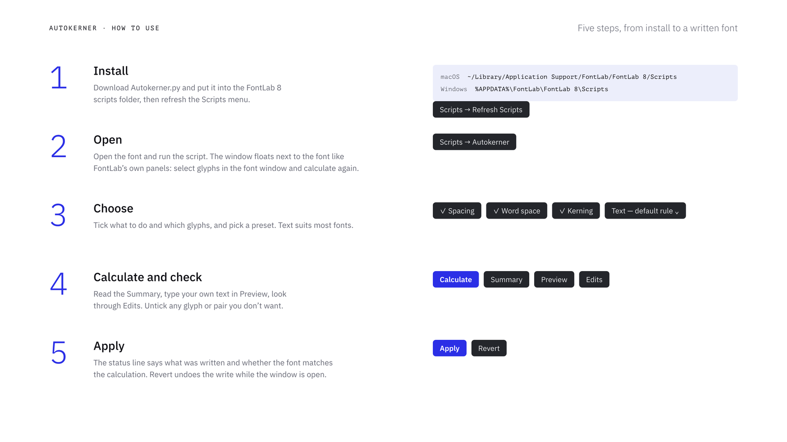

## Use

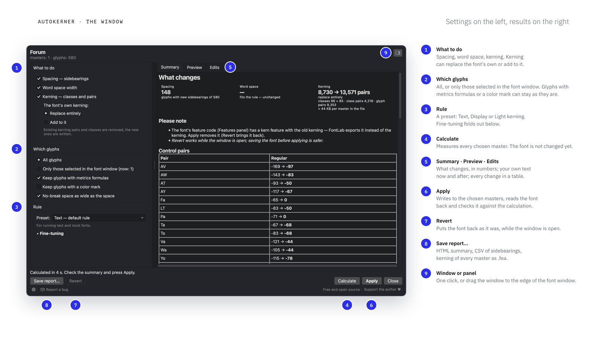

1. Open a font and choose **Scripts → Autokerner**. The window is in Russian
   if your system language is Russian and in English otherwise. It floats next
   to the font like FontLab's own panels, so you can select glyphs in the font
   window and calculate again. It has two formats, a wide window and a narrow
   full-height panel: switch with the button in the top right corner, or drag
   the window by its title bar to the edge of the font window, a FontLab panel
   column or the screen, where it snaps as a panel. The format and position
   are remembered.
2. On the left, from top to bottom:
   - **What to do**: spacing, word space, kerning. Kerning can **replace** the
     existing kerning or **add to it** (your pairs and classes stay; only
     missing pairs are added, as glyph pairs).
   - **Which glyphs**: all, or only the glyphs selected in the font window.
     Glyphs with FontLab metrics formulas (`=H`) and glyphs with a color mark
     can be left untouched. The no-break space can follow the word space.
   - **Masters** (multi-master fonts): which masters to calculate and write.
   - **Rule**: a preset (Text, Display, Light kerning) and, folded, the
     settings behind it: looseness, sensitivity, word space and how far a too
     wide word space is narrowed (to the edge of the tolerance, or all the way
     to the target, which suits condensed and display faces); kerning strength,
     threshold, clearance, figures with `, . :`, class precision, the limit of
     glyph pairs, rounding, the strongest and the loosest allowed pair.
3. Press **Calculate**. On the right: **Summary** (what will change, in
   numbers, and what to check), **Preview** (your own text now and after;
   glyphs with new sidebearings are shown in blue; `/name` inserts a glyph by
   name) and **Edits** (every respaced glyph and the largest kerning changes;
   searching by character or glyph name lists all pairs of a glyph).
4. Press **Apply**. The status line reports what was written and the result of
   the read-back check. **Revert** undoes the last write while the window is
   open. Saving the font before applying is still the safest undo.
5. **Save report…** writes the summary (HTML), the sidebearing changes (CSV)
   and the kerning of every master as feature code (`.fea`).

Settings are remembered between runs. **Stop** interrupts a long calculation
without changing the font.

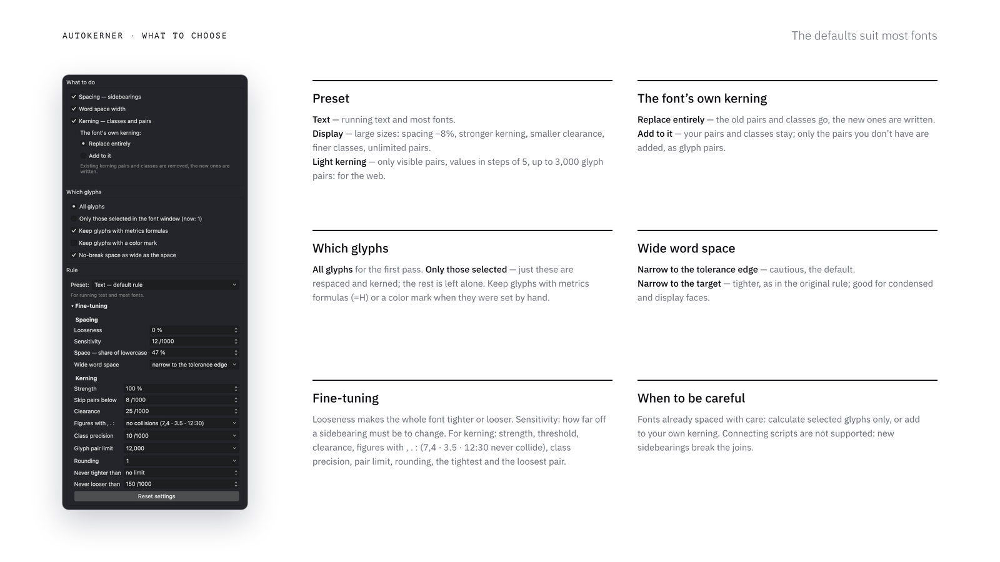

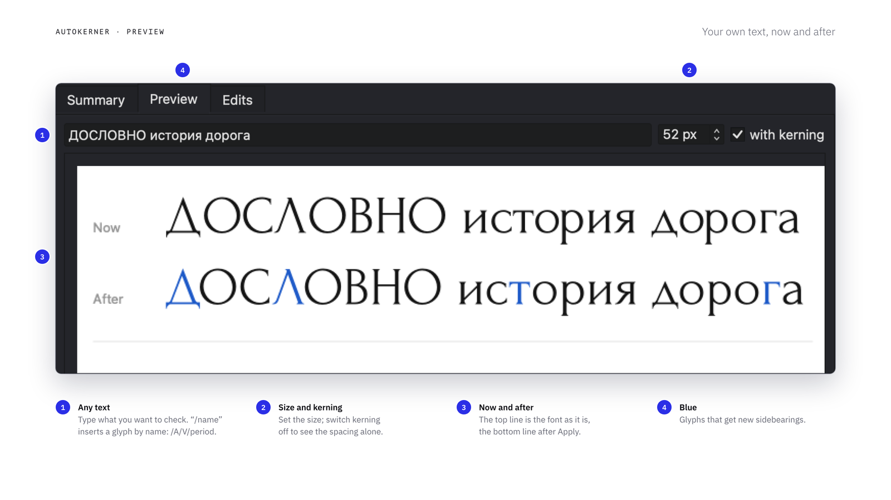

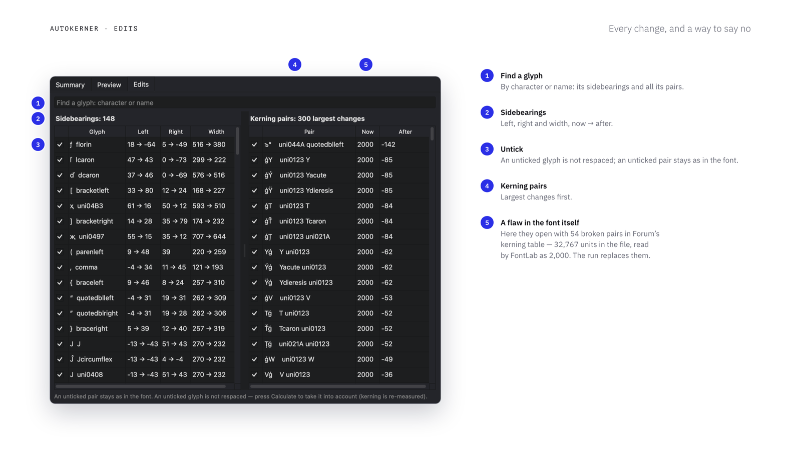

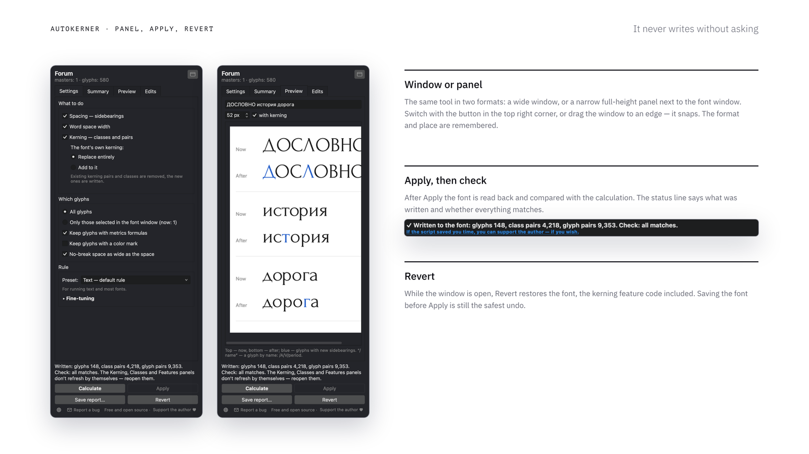

## When to use it, and when not

Autokerner is most useful on fonts whose spacing or kerning is uneven:
early versions, fonts with partial or missing kerning, a script added to an
existing Latin (Cyrillic without kerning is a common case), or a quick first
pass before manual work.

- On fonts that are already carefully spaced, the rule still moves some
  letters: about a third of the Latin and Cyrillic letters of ten well-spaced
  fonts, by about 2.5% of the em on average (both sides together). For such
  fonts, calculate only the glyphs you select, or use **add to it** for
  kerning.
- The overall tightness of the font is kept. If you want the whole font
  tighter or looser, use the looseness setting or the Display preset.
- Connecting scripts are not supported: changing sidebearings breaks the
  joins.
- Only horizontal metrics are changed. Outlines are not redrawn; a glyph
  moves as a whole when its left sidebearing changes, with its anchors and
  components.

## Known limitations

- FontLab's **Kerning**, **Classes** and **Features** panels do not refresh by
  themselves after a script writes. Close and reopen them
  (**Window → Panels**).
- A font opened from OTF or TTF keeps its old kerning as text in the `kern`
  feature, and FontLab exports that text instead of the kerning. Autokerner
  removes the `kern` feature when it writes kerning, so FontLab builds it from
  the kerning on export. Hand-written code in that feature is removed too;
  **Revert** restores it.
- In FontLab 8 kerning classes belong to each master. Autokerner writes the
  same classes to every chosen master; if only some masters of a variable font
  are calculated, their classes will differ from the others. Calculate all
  masters of a variable font at once.
- **Add to it** writes glyph pairs, not classes. On a font that already has
  kerning this can be thousands of pairs (7,923 added to 1,539 on one test
  font).
- Pairs are measured one at a time, so a pair can still collide with a third
  glyph. Figures with `, . :` are protected by default; other sequences are
  worth checking in **Preview**.
- Very spiky display shapes get less kerning than a designer would give them
  by eye, because the pocket is measured between the extreme points.
- A script panel cannot be docked inside FontLab's own panel columns: there is
  no documented API for it, and a panel inserted there crashes FontLab when
  dragged (FontLab 8.4.3). The panel snaps next to FontLab's windows instead.
- A variable OTF opened with **Keep fractional** gives masters with fractional
  coordinates, and kerning measured on them differs noticeably (11,792
  exception pairs instead of 3,948 on one test font). Open such fonts with
  **Round**.
- Speed: pure Python, as FontLab has no numpy. A font of 500 glyphs takes a
  few seconds per master; 2,000 glyphs take about a minute per master.

### Why is there a limit on glyph pairs?

All pairs are always measured (n × n on every master). The limit only decides
how many exception pairs, the pairs that do not fit their class, are written.
For fonts of up to several hundred glyphs it does not change anything: on
test fonts of 182 and 312 glyphs the result is identical with and without it.
For large fonts it matters: a font of 1,820 glyphs gets 16,138 exception pairs
(GPOS ≈ 68 KB) with the default limit of 12,000 and 178,525 pairs (≈ 602 KB)
without it; a font of 2,762 glyphs gets 59,538 pairs (≈ 147 KB) against
499,702 (≈ 1.5 MB). The difference is mostly rare pairs of accented and
unencoded glyphs. Choose **no limit** if file size does not matter.

## Support and bug reports

- Please report bugs in [Issues](../../issues) or by email
  (pavljenko@ya.ru; **Report a bug** in the window copies the address).
  Mention the font, what you pressed and what you saw; a screenshot helps.
- Autokerner is free and will stay free. Support for the author is voluntary
  (**Support the author ♥** in the window, or at
  [pavljenko.ru](https://pavljenko.ru)); it does not unlock anything.
- Updates are made when possible; they are not guaranteed.

## Development

- `autokerner/`: the calculation in pure Python (`auto.run` over
  `model.Master`; `options.Options` holds the window's settings and
  corrections, `Options.classic()` the original rule), the FontLab bridge
  (`fontlab_bridge.py`) and the window (`fontlab_ui.py`).
- `python3 tools/build_fontlab_script.py` builds `dist/Autokerner.py`, a single
  file with all modules inside. It is kept in the repository for download:
  rebuild it whenever the package changes.
- `python3 tools/build_web.py` builds the web version:
  `dist/web/autokerner-article.html` is pasted into the article on the site as
  is, `dist/web/preview.html` is the same on a page of its own
  (`preview.html?font=address` opens a font at once). Sources: `web/` (page and
  worker), `autokerner/web.py` (what the page calls), `autokerner/fontfile.py`
  (reading and writing font files).
- `python3 -m unittest discover tests` runs the tests (outside FontLab they
  need fontTools). `tools/verify_export.py` checks a font exported from
  FontLab after **Apply** against the calculation.

Code comments and identifiers are in Russian.

## License

MIT, see [LICENSE](LICENSE). Copyright © 2026 Sasha Pavljenko.
The license covers the script; fonts processed with it remain their authors'.
