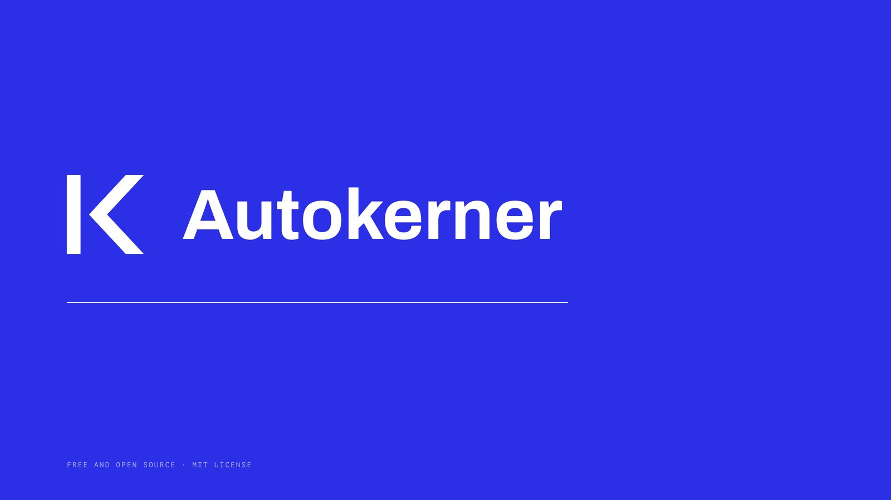
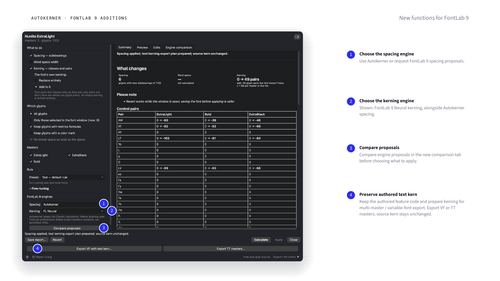

# Autokerner

## [FontLab 8](docs/fontlab8.md) | [FontLab 9](docs/fontlab9.md)

Free spacing and kerning proposals. Calculate, inspect and choose what to apply.
The designer makes the final decision.

| [FontLab 8 — Classic 1.0.1](docs/fontlab8.md) | [FontLab 9 — Hybrid 0.1.0 beta](docs/fontlab9.md) |
|---|---|
| Autokerner's own spacing and kerning engines. | Choose Autokerner or FontLab 9 engines for spacing and kerning independently. |
| Existing full interface, Fine-tuning, RU/EN/DE, selected glyphs and masters, classes, reports and Revert. | The same interface, plus proposal comparison and a preserving route for authored text `kern`, MM/VF export and original `avar` storage in VFJ. |
| Fixes spacing of independently changed composite letters. | Includes the same composite-letter fix. Public beta; finite coverage, not universal compatibility. |
| **[Download FontLab 8 ZIP](https://github.com/pavljenko/Autokerner/releases/download/v1.0.1/autokerner-v1.0.1.zip)** | **[Download FontLab 9 ZIP](https://github.com/pavljenko/Autokerner/releases/download/fl9-v0.1.0-beta.1/autokerner-fontlab9-v0.1.0-beta.1.zip)** |

[Русский](README.ru.md) · [Changes](CHANGELOG.md) · [Validation and limits](docs/validation/README.md)

FontLab 9's improved tools make a hybrid workflow useful: try Autokerner spacing
with native kerning, or compare other combinations before applying. Neither
edition promises to improve every finished typeface. Review words and pairs;
ascenders and descenders may still overlap with the default kerning policy.

## FontLab 9: interface and selected examples

[Six approved slides: interface, method and four examples](docs/slides/fontlab9.html)
([PNG files](docs/images/fontlab9)). Three examples start from unchanged original
spacing; one uses repeatable bearing perturbations. These selected cases are
local comparisons, not an overall ranking. [Method](docs/fontlab9.md#spacing-examples).

## Browser edition

The Classic calculation also runs [in the browser](https://pavljenko.ru/blogs/tools/autokerner).
The [1.0.1 browser build](https://github.com/pavljenko/Autokerner/releases/download/v1.0.1/autokerner-web-v1.0.1.zip)
includes the composite-letter fix. This repository update does not itself update
the separate website. Static TTF/OTF/WOFF/WOFF2 only; fonts stay on your computer.

## Author and support

Sasha Pavljenko · [pavljenko.ru](https://pavljenko.ru) ·
[Voluntary support](https://pavljenko.ru/product/autokerner?lang=en) ·
[Issues](https://github.com/pavljenko/Autokerner/issues) · pavljenko@ya.ru.
Free and open source under [MIT](LICENSE). Processed fonts remain their authors'.

## Source and builds

- `autokerner/`: Classic/FontLab 8 and browser source.
- `editions/fontlab9/`: isolated FontLab 9 source, export profile and fontTools license.
- `python3 tools/build_fontlab_script.py`: `dist/Autokerner.py`.
- `python3 tools/build_web.py`: browser files.
- `python3 tools/build_fontlab9.py`: `dist/Autokerner9.py`.
- `python3 tools/package_release.py`: verified archives and checksums.
- `python3 -m unittest discover -s tests`: Classic tests (fontTools required).

FontLab 8.4.3/macOS has historical coverage. The 1.0.1 calculation was checked
against v1.0.0 on six real fonts; the repair was also tested in FontLab 9.
A fresh FontLab 8 runtime was unavailable. Windows is unverified.
