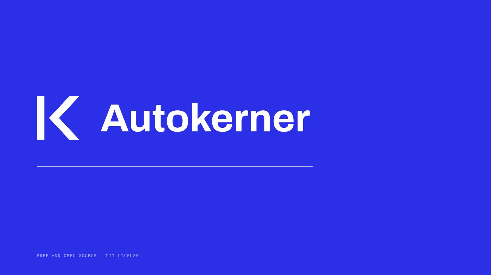
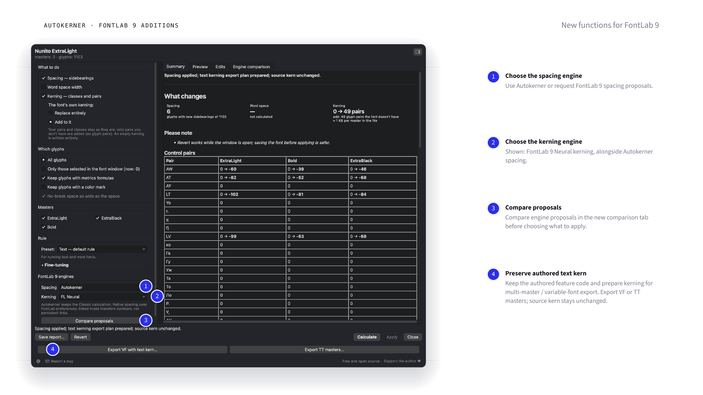

# Автокернер

## [FontLab 8](docs/fontlab8.ru.md) | [FontLab 9](docs/fontlab9.ru.md)

Бесплатные предложения апрошей и кернинга. Скрипт считает, дизайнер проверяет
и выбирает, что применить.

| [FontLab 8 — Classic 1.0.1](docs/fontlab8.ru.md) | [FontLab 9 — Hybrid 0.1.0 beta](docs/fontlab9.ru.md) |
|---|---|
| Собственные движки апрошей и кернинга. | Независимый выбор Autokerner или движков FontLab 9 для апрошей и кернинга. |
| Прежний полный интерфейс, Fine-tuning, RU/EN/DE, выбранные знаки и мастера, классы, отчёты и откат. | Тот же интерфейс плюс сравнение предложений, сохраняющий путь для текстовой `kern`, MM/VF-экспорт и исходная `avar` в VFJ. |
| Исправлены независимо изменённые апроши составных букв. | То же исправление. Публичная бета, а не обещание совместимости со всеми шрифтами. |
| **[Скачать для FontLab 8](https://github.com/pavljenko/Autokerner/releases/download/v1.0.1/autokerner-v1.0.1.zip)** | **[Скачать для FontLab 9](https://github.com/pavljenko/Autokerner/releases/download/fl9-v0.1.0-beta.1/autokerner-fontlab9-v0.1.0-beta.1.zip)** |

[English](README.md) · [Изменения](CHANGELOG.md) · [Проверки и ограничения](docs/validation/README.md)

Новые инструменты FontLab 9 позволяют сочетать подходы: например, собственные
апроши Autokerner и встроенный кернинг. Предложения можно сравнить перед
применением. Универсального улучшения любого готового шрифта не обещаем:
окончательное решение остаётся за дизайнером. Хвосты и выступы при стандартной
политике кернинга могут пересекаться.

[Утверждённые слайды FontLab 9](docs/slides/fontlab9.html) · [PNG](docs/images/fontlab9).
Три примера используют исходные апроши без порчи, один — контролируемые
изменения. Это выбранные случаи, не рейтинг движков.

## В браузере

[Веб-версия](https://pavljenko.ru/blogs/tools/autokerner) ·
[Сборка 1.0.1](https://github.com/pavljenko/Autokerner/releases/download/v1.0.1/autokerner-web-v1.0.1.zip).
Архив содержит исправление; обновление GitHub само по себе не меняет отдельный
сайт. Статичные TTF/OTF/WOFF/WOFF2 обрабатываются на компьютере пользователя.

## Автор и поддержка

Sasha Pavljenko · [pavljenko.ru](https://pavljenko.ru) ·
[Добровольная поддержка](https://pavljenko.ru/product/autokerner) ·
[Сообщить об ошибке](https://github.com/pavljenko/Autokerner/issues) · pavljenko@ya.ru.
[MIT](LICENSE). Права на шрифты остаются у их авторов.

Разработано с помощью Claude и OpenAI Codex.

Проверки FontLab 8.4.3/macOS — исторические. Расчёт 1.0.1 сверён с исходником
1.0.0 на шести реальных шрифтах; исправление проверено также в FontLab 9.
Свежий прогон в FontLab 8 недоступен. Windows не проверен.
