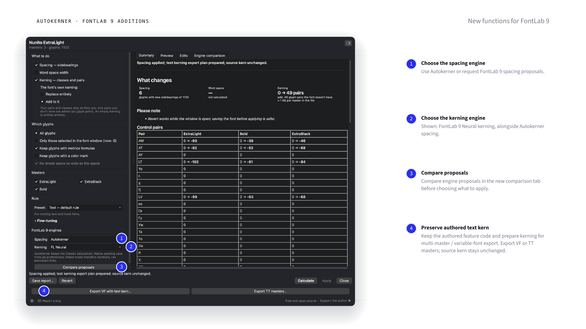
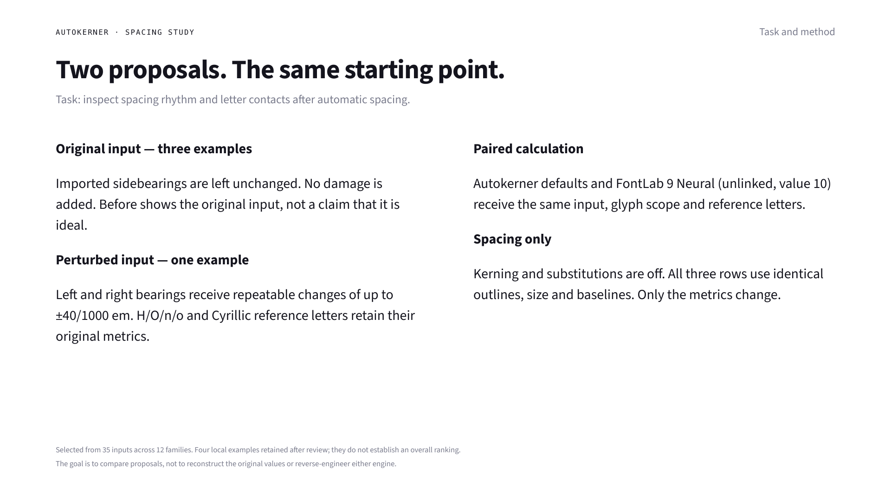
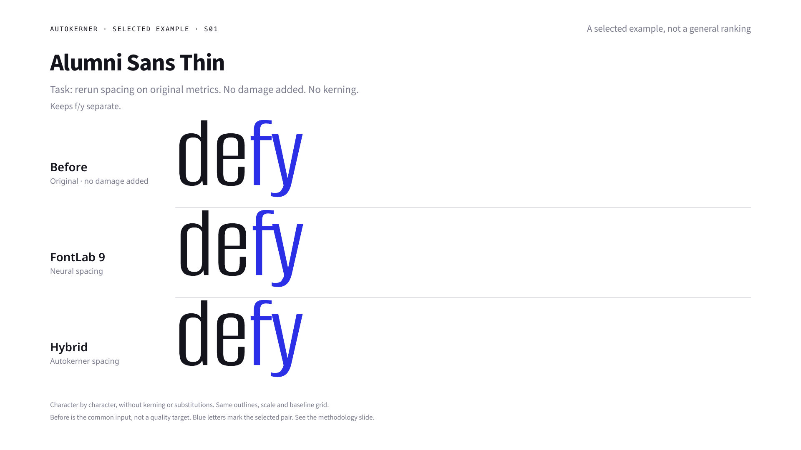
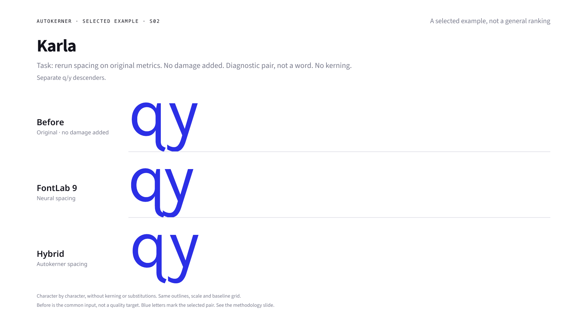
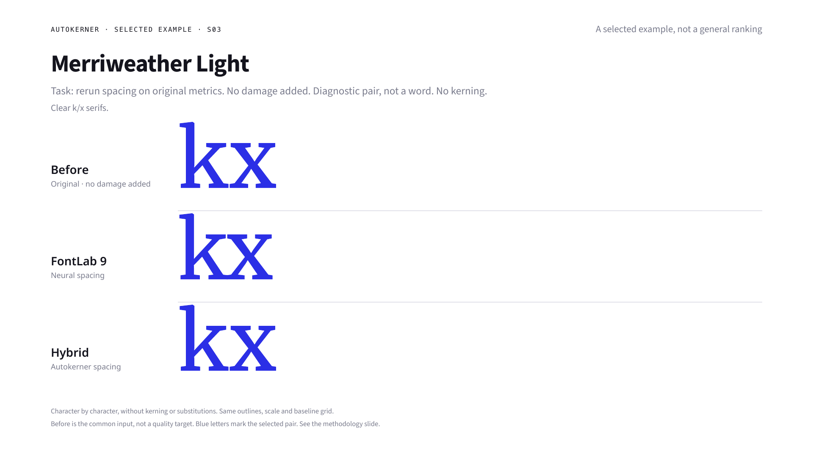
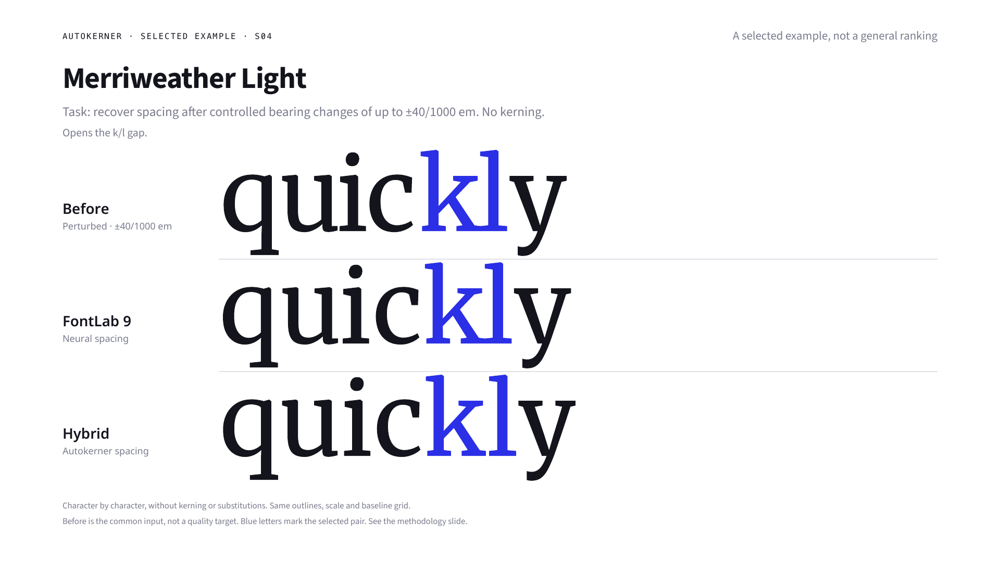

**[FontLab 8](fontlab8.md) | FontLab 9** · [Русский](fontlab9.ru.md)

# Autokerner 9 Hybrid · 0.1.0 beta

[Download installation ZIP](https://github.com/pavljenko/Autokerner/releases/download/fl9-v0.1.0-beta.1/autokerner-fontlab9-v0.1.0-beta.1.zip)
· [Release notes](releases/fl9-v0.1.0-beta.1.md) · [Validation](validation/README.md)

Use Autokerner spacing with a FontLab 9 kerning engine, or choose another
combination. The hybrid compares proposals; it does not automatically decide
which is optically best. FontLab 9's native engines are valuable additions,
and the designer remains in control.

## Added to the full Classic interface

- Independent spacing and kerning engine selectors, including FontLab's native methods.
- Compare proposals on the same input before choosing a candidate to review and apply.
- Authored text `kern`: explicitly choose **Add to it**. Existing rules are preserved;
  new uncovered pairs follow a separate preserving route. Replace is blocked for this representation.
- With multiple masters and text `kern`, Apply writes selected spacing and prepares
  a kerning export plan. **Export VF** / **Export TT masters** create files without
  replacing the project's authored feature text. Revert restores spacing and discards the plan.
- The original supported `avar` mapping can travel in VFJ user data through normal Save.
  A changed author axis mapping takes priority. See the export limits below.
- Stronger stale-result and Undo guards; temporary copies are closed after use.

Fine-tuning, presets, RU/EN/DE, selected glyphs, chosen masters, protected marks
and formulas, classes, exceptions, reports, Stop, Revert and author links are retained.
The arbitrary 80-glyph prototype cap is absent. The composite-letter spacing repair
is shared with Classic 1.0.1; no font-specific g/j exception was added.

## Install and use

1. Unzip the FontLab 9 archive. Copy `Autokerner9.py` into
   `~/Library/Application Support/FontLab/FontLab 9/Scripts` on macOS, or
   `%APPDATA%\FontLab\FontLab 9\Scripts` on Windows. Windows is unverified.
2. Refresh Scripts, open a font, run **Autokerner 9 Hybrid**. Preferences
   are separate from the FontLab 8 edition.
3. For the illustrated combination, choose **Spacing: Autokerner** and
   **Kerning: FL Neural**. Saved choices are respected; the screenshot
   does not change the first-run defaults.
4. Calculate or Compare proposals; inspect Preview/Edits and choose what to apply.
   Keep a saved source copy. Revert operates while the script window is open.
5. For compatible TrueType VF export, import the included
   `resources/Autokerner9-compatible-TT.fl_profile` into FontLab's export profiles first.
   Export checks the profile and axes rather than silently changing drawing.

## Spacing examples

The task was to inspect proposals on identical inputs, not to recover an assumed
perfect original. Three displayed examples start with unchanged original
sidebearings; one has repeatable perturbations up to ±40/1000 em, with reference
letters retained. Before is the common input. Kerning and substitutions are off;
outlines, scale and baselines are identical. These are four selected local cases
from a 12-family/35-input search, not success rates or an overall engine ranking.
Own results were checked again after the composite-letter fix; unchanged native
proposals come from the verified same-input run.

## Important limits

- Public beta, tested on macOS FontLab 9.0.9806. Not a certificate of compatibility
  with every font or export profile. Windows is unverified.
- Classic Preview is not an OpenType shaper: it does not render authored text `kern`,
  including simple pairs, as effective positioning. Preservation/export are checked separately.
- Unsupported or ambiguous text-kerning constructs stop the operation; they are not
  silently rewritten. MM text `kern` prepares export rather than populating visual tables.
- Exact `avar` preservation was verified on one-axis Nunito, avar v1. Other axes
  and mappings need their own checks. Information lost before capture cannot be reconstructed.
- Autokerner's geometry fields control its own engine. Native settings belong to
  FontLab; common filters do not imply access to every native parameter.
- Default kerning allows some ascender/descender overlaps. The Yanone g/j example
  was withdrawn: leaving an excessive gap is not a spacing advantage.
- Unchecking every master retains Classic's existing meaning: all masters.
- Exported files remain after Revert; it does not delete the designer's output files.

Sasha Pavljenko · [support](https://pavljenko.ru/product/autokerner?lang=en)
· [issues](https://github.com/pavljenko/Autokerner/issues). MIT; bundled fontTools
is also MIT, with its license included.
